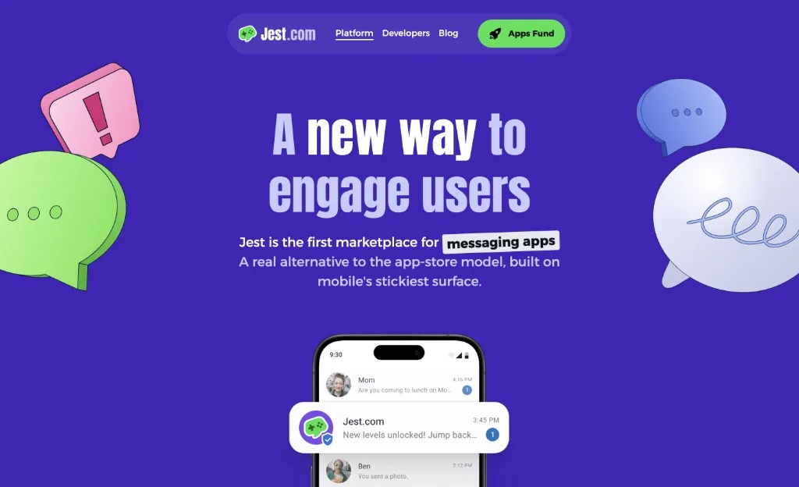
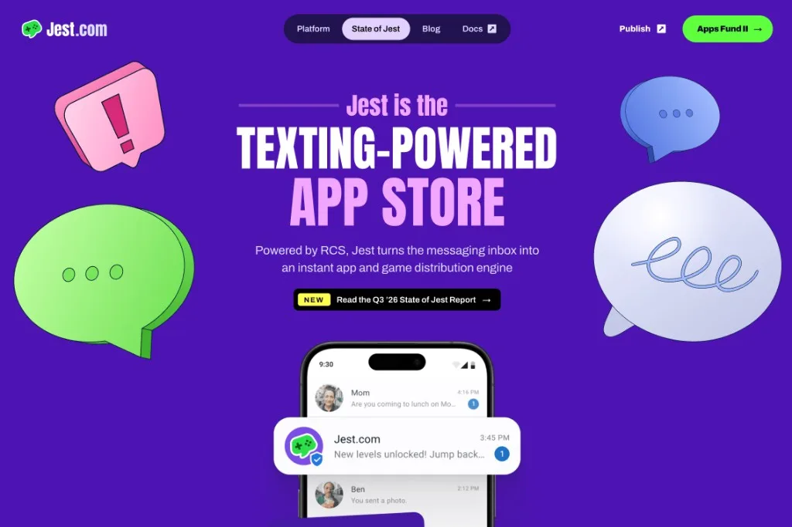
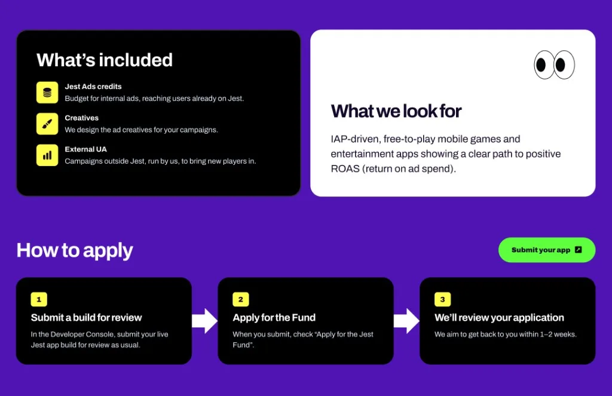

<video autoplay loop muted playsinline src="/assets/jest-website/homepage-scroll.mp4" class="w-100 br4"></video>

The [Jest corporate website](https://about.jest.com/) is a project in itself, separate from [my product design work at Jest](/jest/). Its job is to tell developers and investors what Jest is about, and to present us as a playful tech company that is serious about what it does. I believe we got there.

---

The big question was: **how do we talk about Jest? What's the story?**

I pushed to focus on the story instead of listing features. People have short attention spans, so we wanted to take them on a quick journey and get them interested from the first screen. 

## Version 1

I designed the first version in Figma, after a lot of design explorations. It started as a side project within the company while I was doing mostly product design, so it came together quickly. It launched around February 2026, before our first live event in San Francisco during the Game Developers Conference.

## Version 2

By September, Jest was no longer a new thing. It was an existing product with numbers we wanted to show, we had reached out to the press, and the website needed a refresh to support that.

Since the first version had been a side project, I also tweaked a lot of the visuals to make the whole site look even better. We added:

- A page for the quarterly **State of Jest** report.
- A bunch of new sections.
- A revamped blog with good typography.
- Custom Open Graph images for every page.

<figure>
  
  <figcaption>The Open Graph images are like a mini poster for each page.</figcaption>
</figure>

## The State of Jest report

<video autoplay loop muted playsinline src="/assets/jest-website/story-scroll.mp4" class="w-100 br4"></video>

Usually when a company has a report, the page says “download the PDF and give us your email”. We didn't want that. We wanted to spread the message, and didn’t care about collecting emails to spam people. A PDF download is also an extra step that takes time. You might get distracted and never open it.

So we embedded the presentation on the website. Not the PDF, and not an online presentation maker. We vibe-coded a presentation player: an agent built an interactive, slide-based presentation that lives on its own URL, plus a player we can embed in the page. (The PDF is still there for anyone who wants it.)

The charts are animated. The screenshots sit inside phone frames and use CSS transforms so they look 3D and move.

## Altenrative designs

A lot of exploration went into this. Here are some of the unused design variations I liked:

## Reception

It worked! We got a lot of interest from companies wanting to launch on Jest, and people started asking about our numbers. We always have a place to point them to: the State of Jest.
