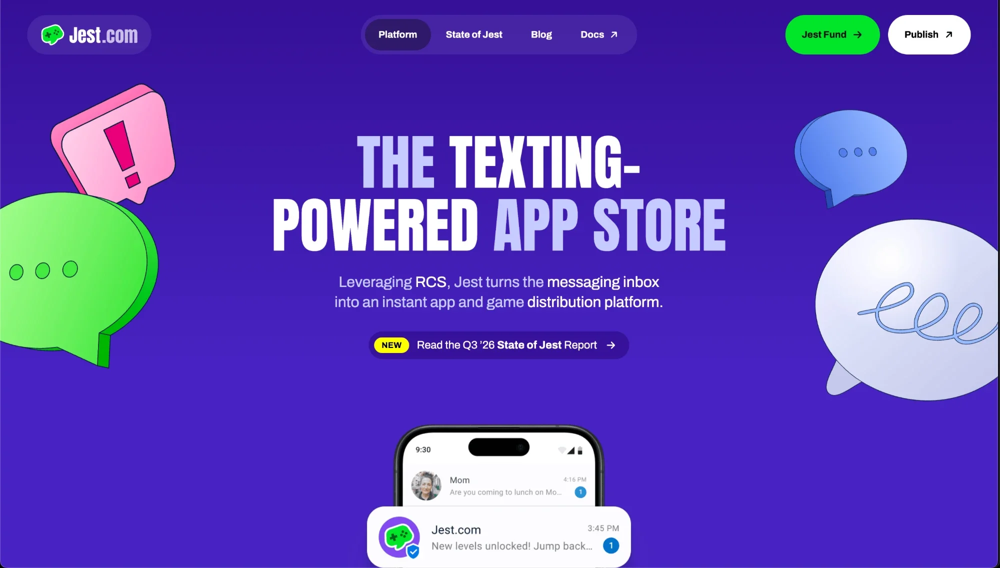
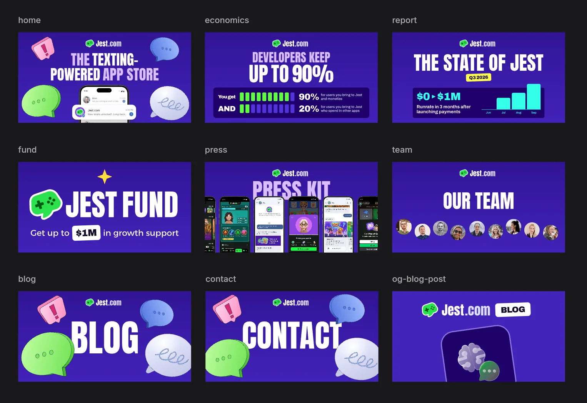
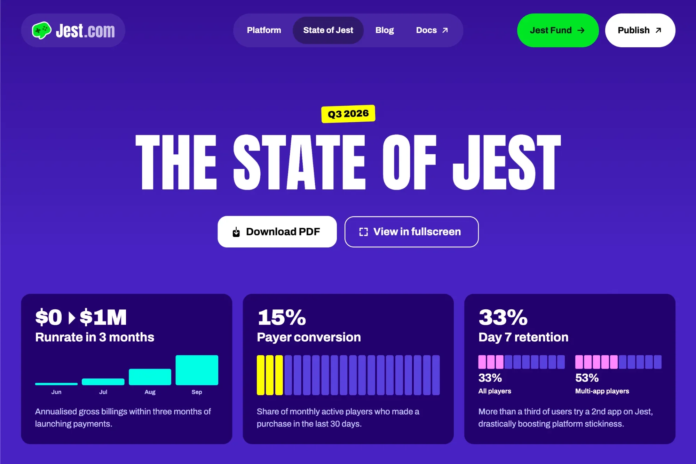
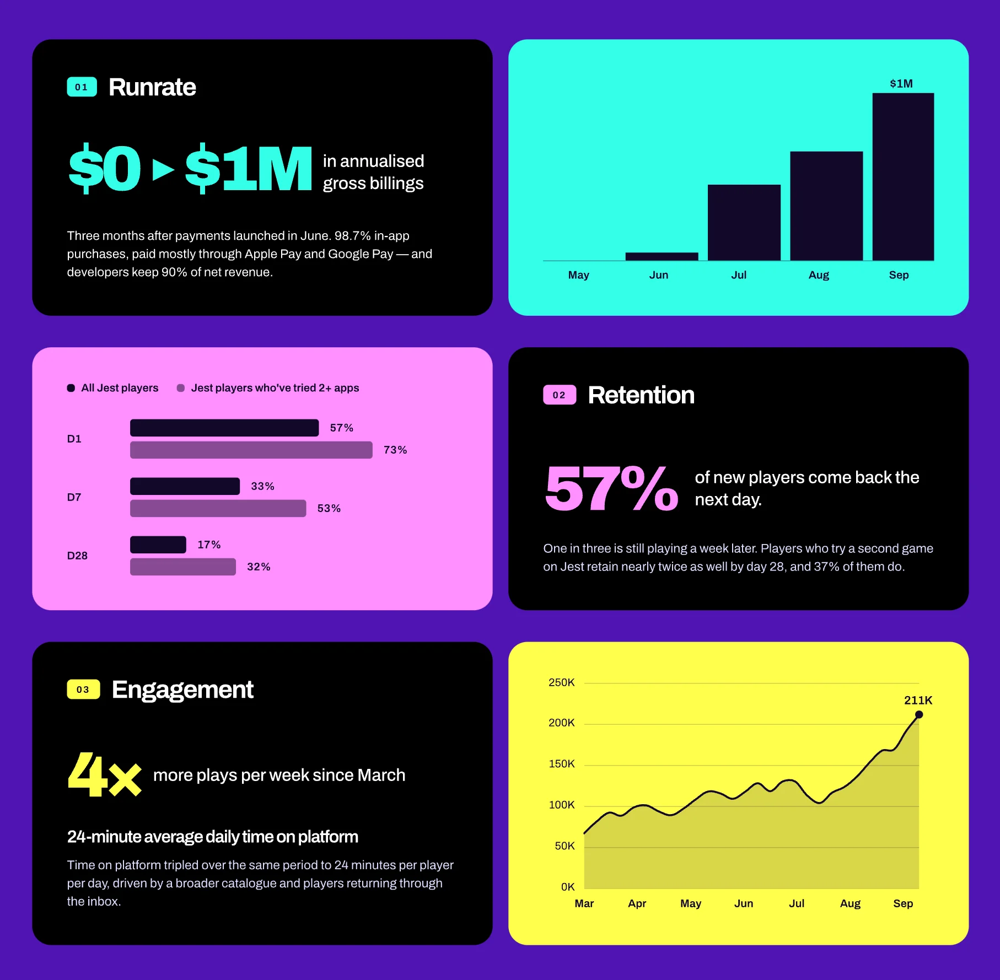
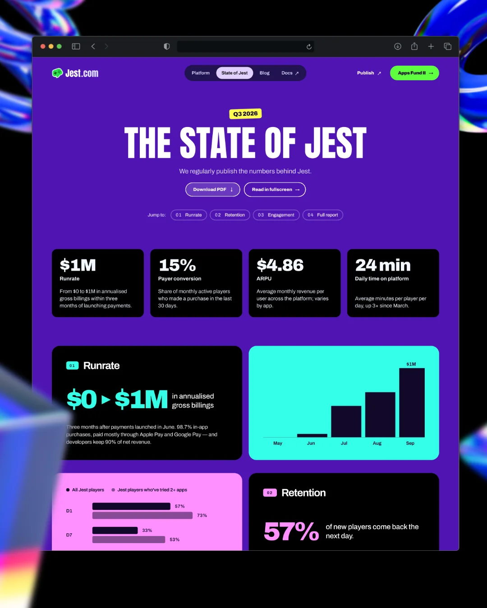

<figure>
  <video autoplay loop muted playsinline src="/assets/jest-website/homepage-scroll.mp4" class="w-100 br4"></video>
  <figcaption>The <a href="https://about.jest.com/">Jest corporate website</a>, scrolled from top to bottom.</figcaption>
</figure>

The [Jest corporate website](https://about.jest.com/) is a project in itself, separate from [my product design work at Jest](/jest/). Its job is to tell developers and investors what Jest is about, and to present us as a playful tech company that is serious about what it does.

That second part set the bar for the visuals. The quality of the graphic design had to be at least on par with other tech companies in playful sectors. I believe we got there.

## The story comes first

I worked closely with the CEO, the main stakeholder, and the biggest question wasn't visual. It was: **how do we talk about Jest? What's the story?**

I pushed to focus on the story instead of listing features. People have short attention spans, so we wanted to take them on a quick journey and get them interested from the first screen. The page goes like this:

1. **What Jest is:** “The texting-powered app store.”
2. **How it works:** a vertical scrolling section with four slides. The text scrolls and the image changes with it, showing a different part of the company each time.
3. **Why this matters, and why now.**
4. **The Jest Fund:** we fund the marketing of new products that come to the platform, because we want everyone to succeed.
5. **Where to go next,** including the blog.

<figure>
  
  <figcaption>The hero. It's the first thing the story says.</figcaption>
</figure>

## Version 1

I designed the first version in Figma, after a lot of design explorations. It started as a side project within the company while I was doing mostly product design, so it came together quickly. It launched around February 2026, before our first live event in San Francisco during the Game Developers Conference.

## Version 2

By September, Jest was no longer a new thing. It was an existing product with numbers we wanted to show, we had reached out to the press, and the website needed a refresh to support that.

Since the first version had been a side project, I also tweaked a lot of the visuals to make the whole site look even better. We added:

- A section presenting Jest as a new paradigm, comparing the old and the new.
- A page for the quarterly **State of Jest** report.
- A blog with careful typography.
- Custom Open Graph images for every page.

I think the last one is really cute. Each image is a mini poster.

<figure>
  
  <figcaption>The Open Graph images for each page.</figcaption>
</figure>

## The State of Jest report

Usually when a company has a report, the page says “download the PDF and give us your email”. We didn't want that. We want to spread the message, and we don't care much about collecting emails to spam people. If you're interested, reach out. A PDF download is also a step that takes time. You might get distracted and never open it.

<figure>
  
</figure>

So we embedded the presentation on the website. Not the PDF, and not an online presentation maker. We vibe-coded a presentation player: an agent built an interactive, slide-based presentation that lives on its own URL, plus a player we can embed in the page. (The PDF is still there for anyone who wants it.) As far as I know, that's pretty unique in the sector.

The charts are animated. The screenshots sit inside phone frames and use CSS transforms so they look 3D and move.

<figure>
  
  <figcaption>Report cards. The charts animate in the player.</figcaption>
</figure>

<figure>
  
</figure>

## Reception

It worked. We got a lot of interest from companies wanting to launch on Jest, and people started asking about our numbers. We always have a place to point them to: the State of Jest.

## A visual language we didn't launch with

I also made a slightly altered visual language that we didn't launch with. We didn't want to increase the scope of the project, and we can always redesign later.

I explored it in [pen.dev](https://pen.dev), a new Figma alternative that agents can use. At first I just asked it to redesign the page and build me something fun. The results looked weird. It seemed to come up with something unique, but after a few hours I realized how it works: it has a handful of pre-made mini design systems, a couple of them tagged as fun, and it draws components and styles from those. You think you're getting something original, but you're getting a template.

I didn't like that, so I changed how I worked with it. I started asking for specific things: suggest a different layout, change these colors to something with this feeling, use these exact colors. That let me try many different directions and see what felt better. I couldn't have explored this many alone.

Is that necessarily good? Maybe. It really gets you unstuck when you're in a rut and ask for a crazy idea. It doesn't matter if the idea comes from a template. It's still different from what you had.

<!-- TODO: add pen.dev canvas screenshots here -->
