**Founding designer · Product, UX/UI & delivery**

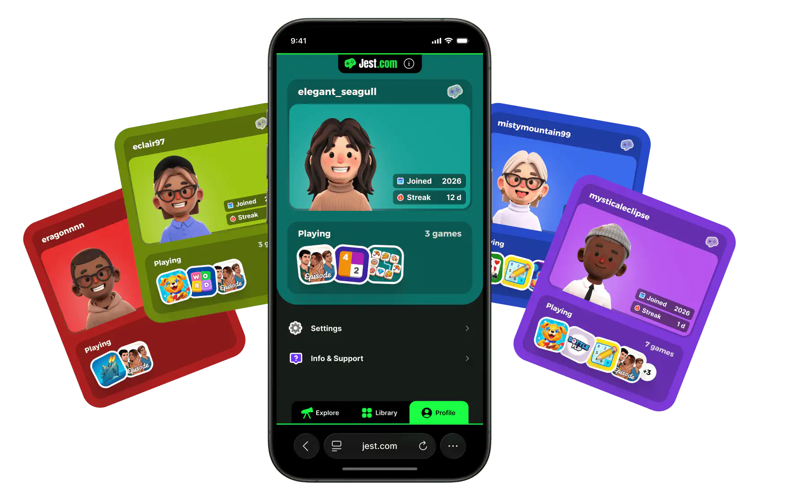

[Jest](https://jest.com/) is a mobile gaming platform built around messaging: you play in your browser, sign up with a text, and come back through a link. In less than a year, it grew from nothing to 100k+ monthly active users, and reached a $1M run rate within 3 months of enabling monetization.

At a high-velocity startup everyone wears multiple hats, and I did too. I joined at the prototype stage as the founding designer, owned the UX and UI of the whole platform, and stepped in on product management and delivery.

<figure>
  <a href="/jest-website/" class="bn">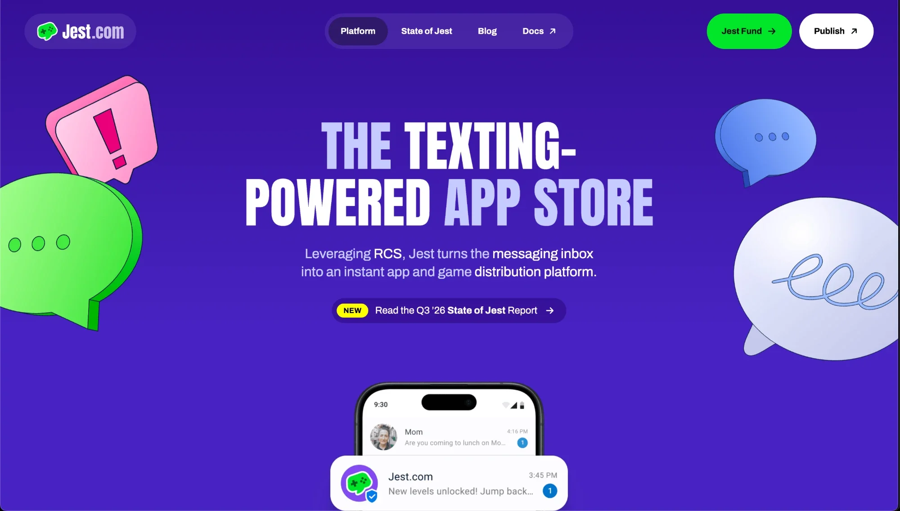</a>
  <figcaption>Related work: <a href="/jest-website/">Jest corporate website ↗</a></figcaption>
</figure>

## Sign up by text

There are no passwords on Jest. You text us, we text you a link, and you're in. It's unusual, so every flow that leads there had to feel natural and trustworthy.

  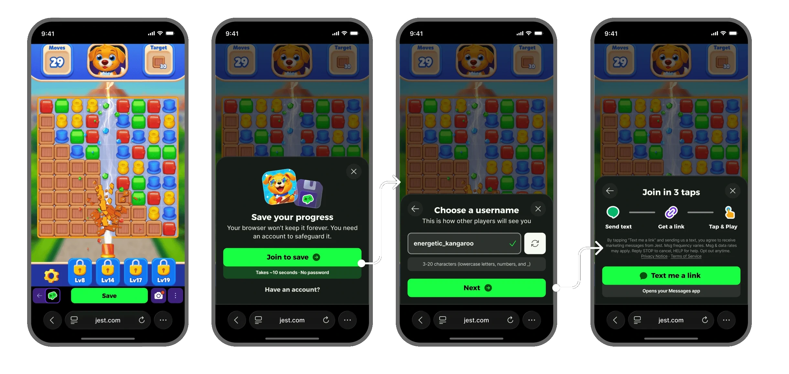
  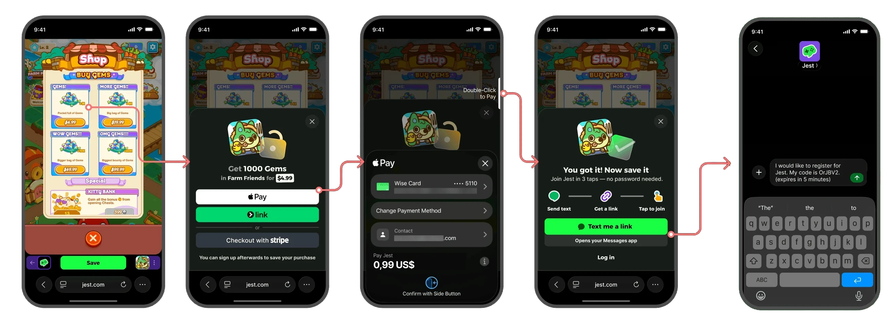

## The platform

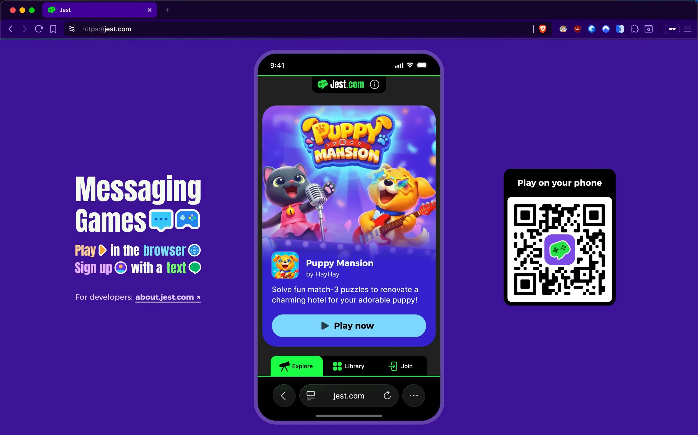

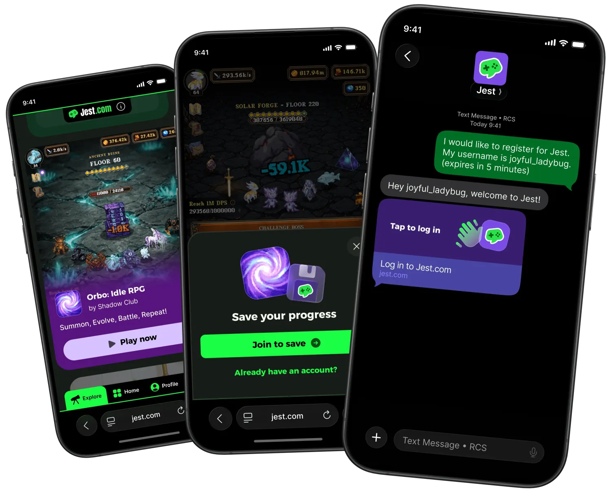

  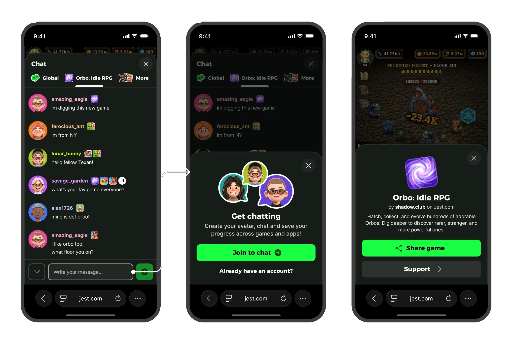

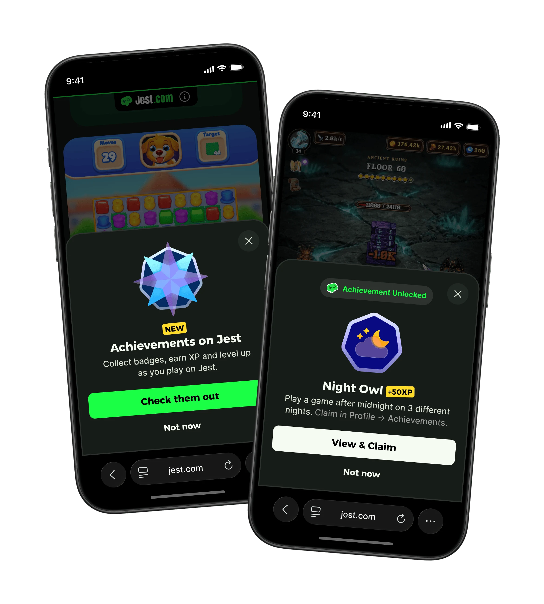

## Product

Besides the screens, I stepped in to own the roadmap, pick and suggest features, write tickets, and coordinate the people building them. I used Figma prototypes and recorded walkthroughs to align the team, and built a custom Notion project management board. After a short while at Jest, I started shipping my own designs to production with Claude Code, and fixing bugs.

<figure>
  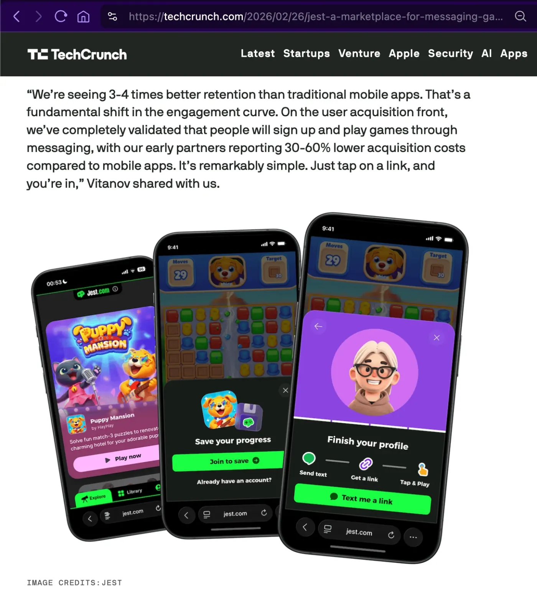
  <figcaption><a href="https://techcrunch.com/2026/02/26/jest-a-marketplace-for-messaging-games-is-challenging-the-app-store-status-quo/">TechCrunch coverage</a>, February 2026.</figcaption>
</figure>

<section class="wide-gallery" aria-labelledby="more-explorations">
  <h2 id="more-explorations">More explorations</h2>

  <a href="/assets/jest-proposal/handpicked/exploration-for-you-variants-50ac3fbfc4c0.webp" class="masonry-item bn">
    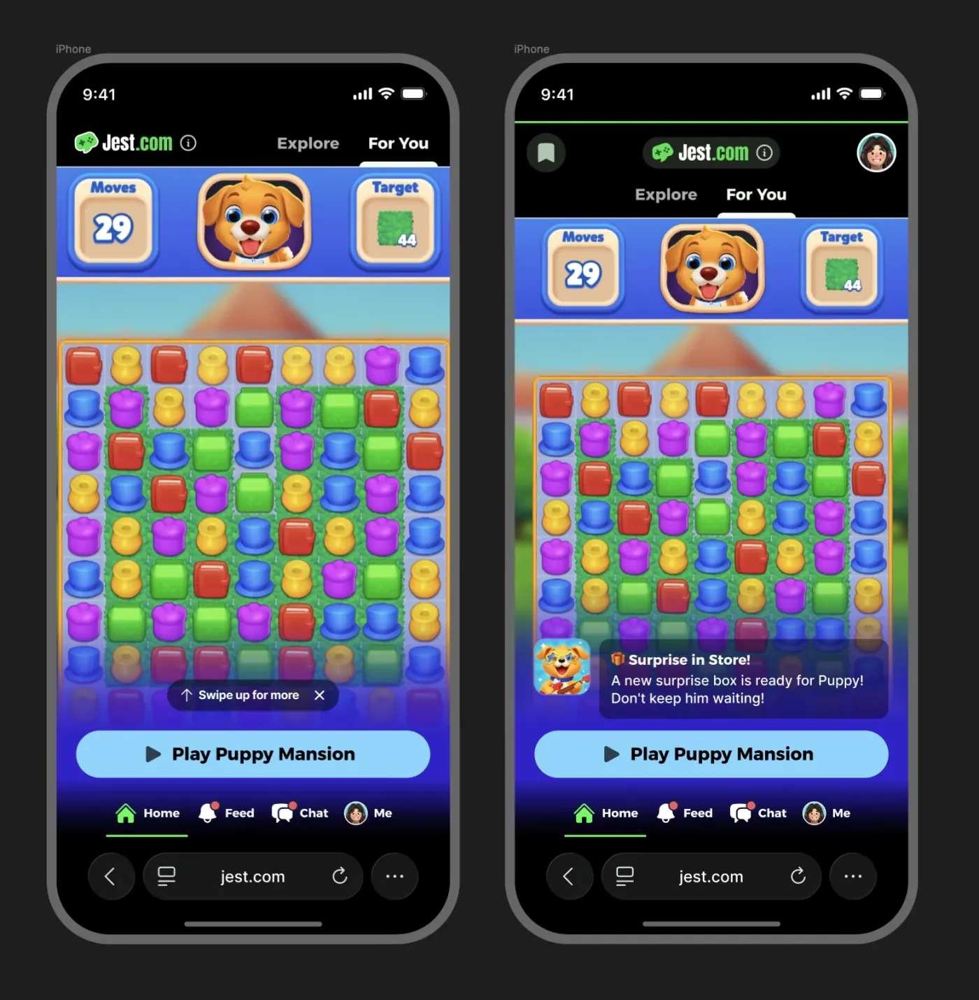
  </a>
  <a href="/assets/jest-proposal/handpicked/exploration-guest-and-member-249567296fd3.webp" class="masonry-item bn">
    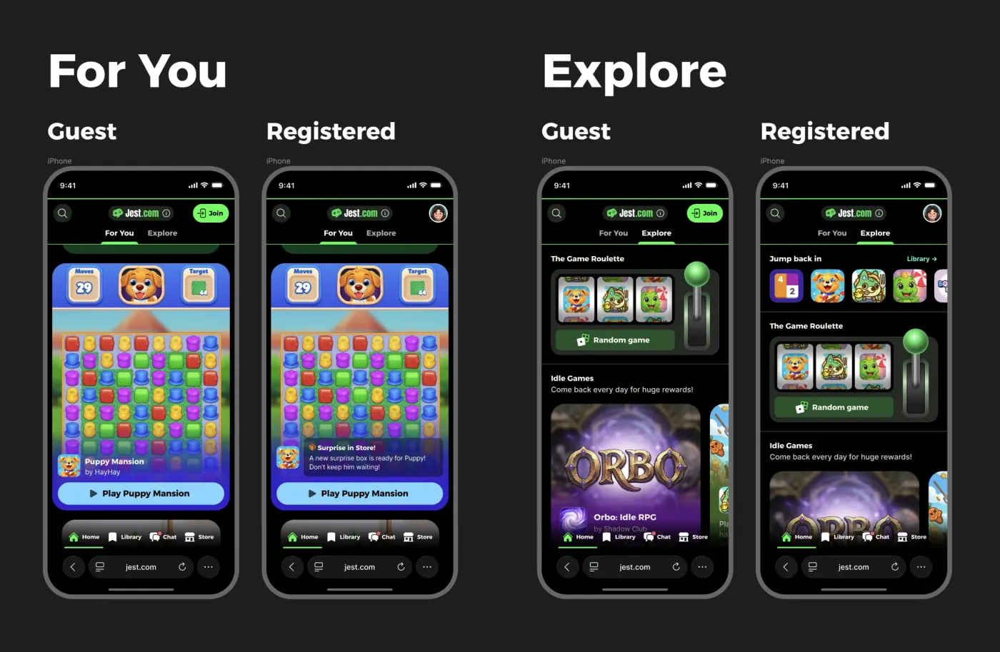
  </a>
  <a href="/assets/jest-proposal/handpicked/exploration-badge-flow-b1e8f97b143c.webp" class="masonry-item bn">
    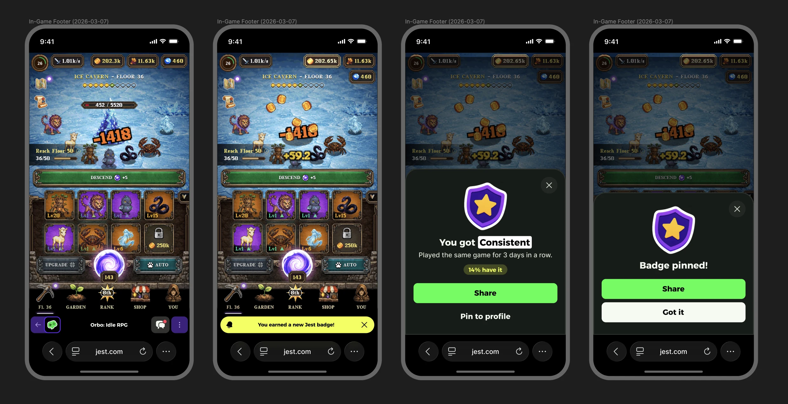
  </a>
  <a href="/assets/jest-proposal/handpicked/exploration-chat-196ee204563d.webp" class="masonry-item bn">
    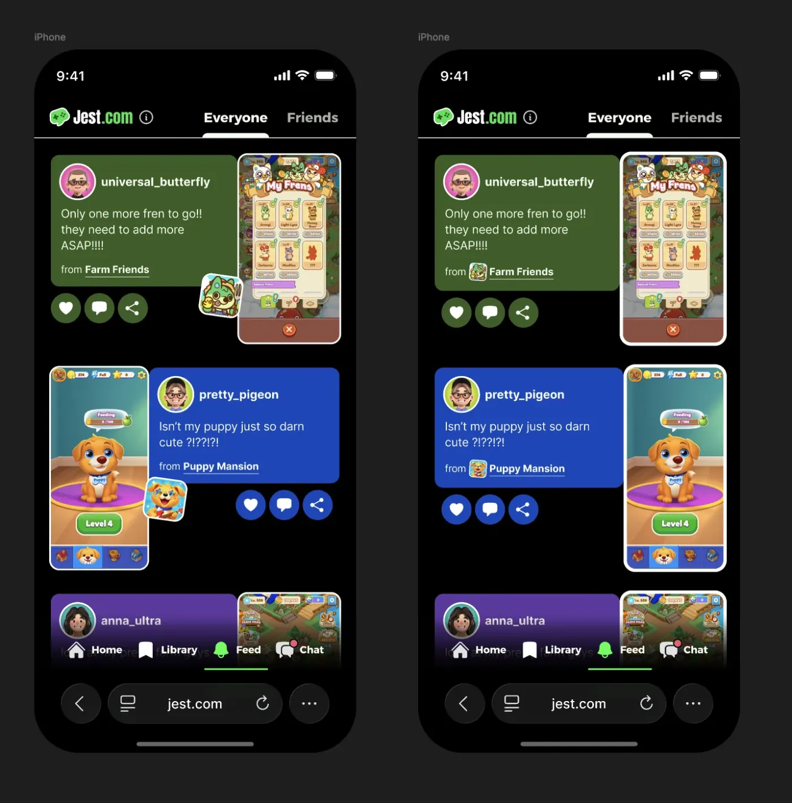
  </a>
  <a href="/assets/jest-proposal/handpicked/exploration-profile-details-d56b4df7d0da.webp" class="masonry-item bn">
    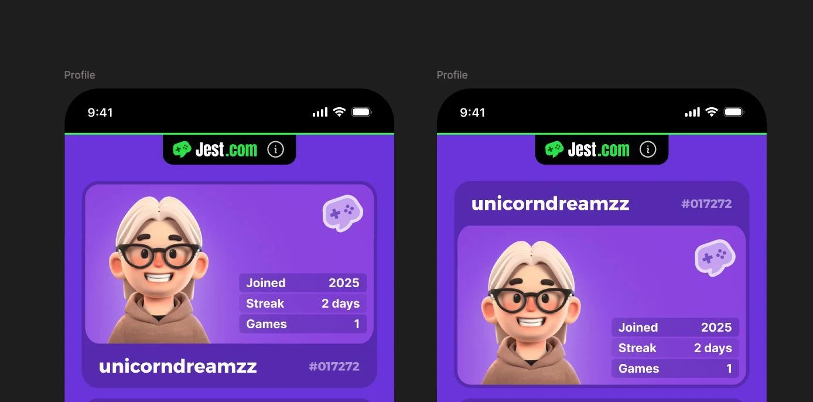
  </a>
  <a href="/assets/jest-proposal/handpicked/exploration-public-profile-21630f5cb974.webp" class="masonry-item bn">
    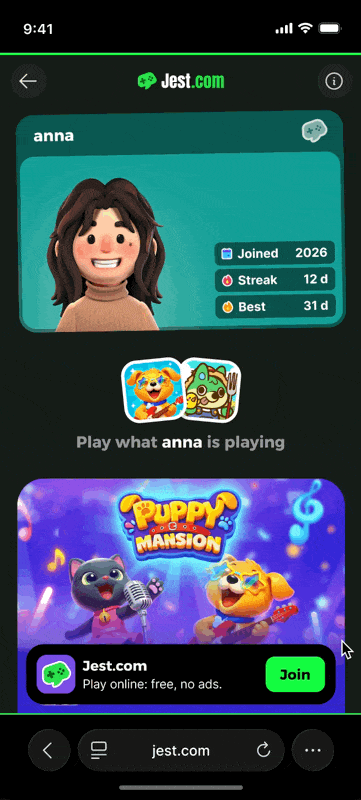
  </a>

</section>
