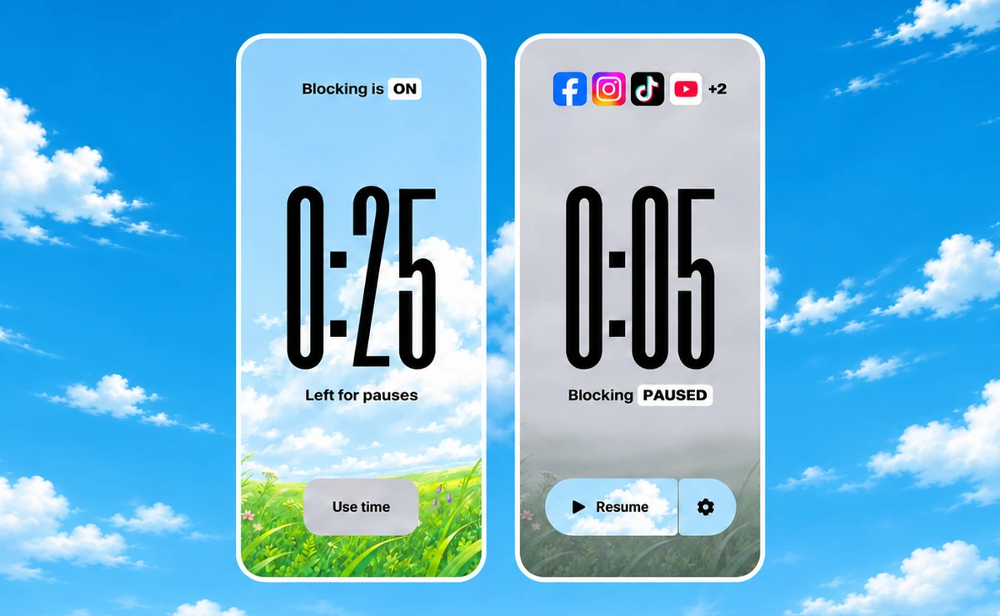
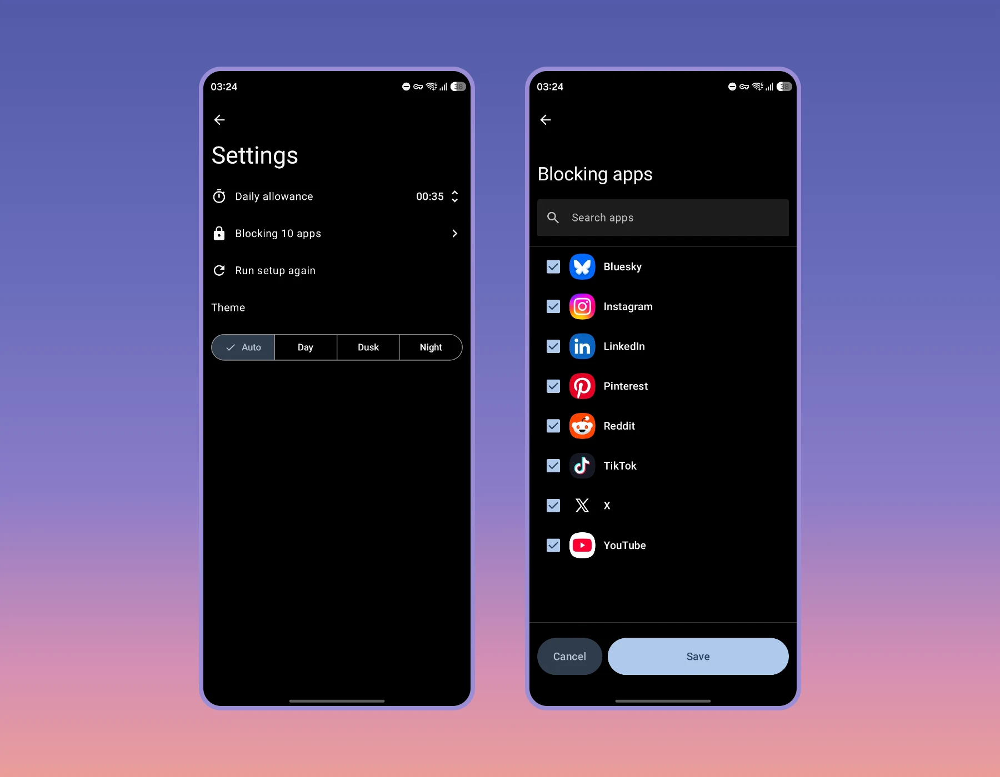
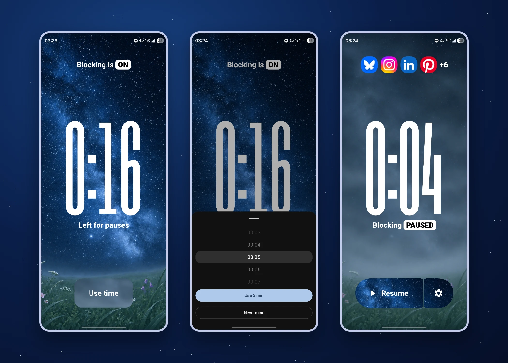
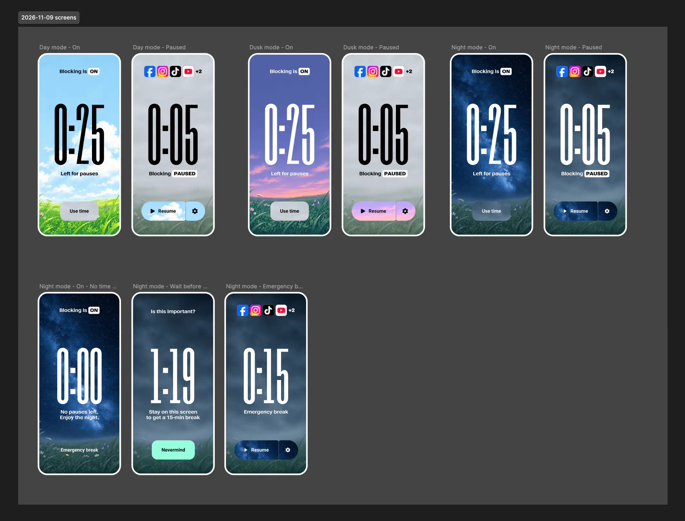
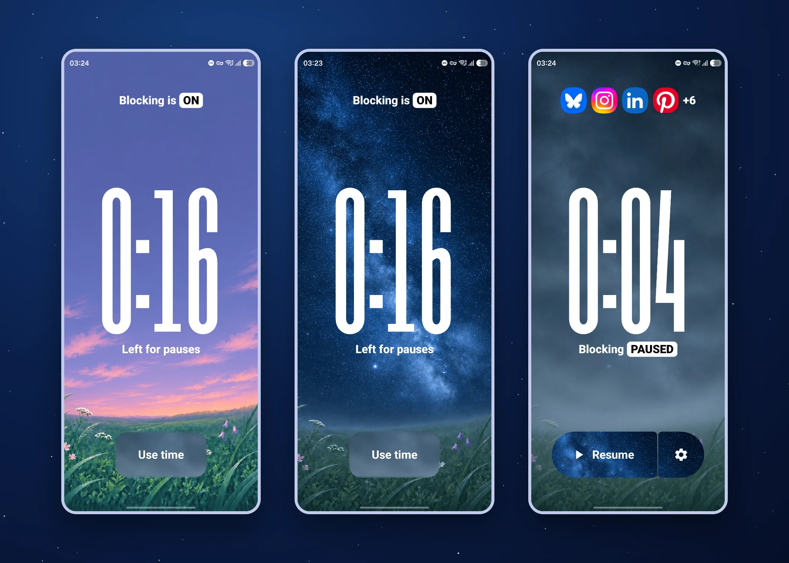

**Personal project · Android app**

[Limit](https://freedom.to/limitapp) is a free iOS app from the makers of Freedom, which I also use. I emailed the developers and they have no immediate plans for an Android version, so I made my own take on it.

## The idea

Choose which apps to block and how much time you can unblock them for each day.

When you pause blocking, the timer runs whether you use the apps or not.

That makes you think before you open the apps. Or rather, it retrains you to have a goal and estimate how much time you’ll need in the session to complete it. It keeps you focused: “I only have 5 minutes this session, better be quick.”

Standard screen time tools usually let you use an app normally until you hit the limit. But I don’t want to open the apps mindlessly, get sucked in, and accidentally hit the limit. I want to know why I’m opening them. I want to use them, I don’t want to delete them, but I want to use them on my own terms to get what I want out of them.

## How I built it

I put Cursor to work, first describing the functionality in detail and testing to make sure it works, then changing the UI to match the vibe I was going for.

## The visual metaphor

The meadow is clear when the apps are blocked, just like your mind. When the apps get unblocked, it’s foggy, like your brain. Personally, that slightly motivates me to keep the meadow clear and beautiful.

The feeling I want to evoke is “look at this beautiful meadow… let’s keep it that way”, and to have people realize it’s a metaphor for their own mind.

The theme switches automatically based on the time of day: dawn, day, dusk and night. You can also lock it to your favorite theme.

## Next

I want to add nice animations and subtle looping video instead of image backgrounds, to make it even more immersive.
