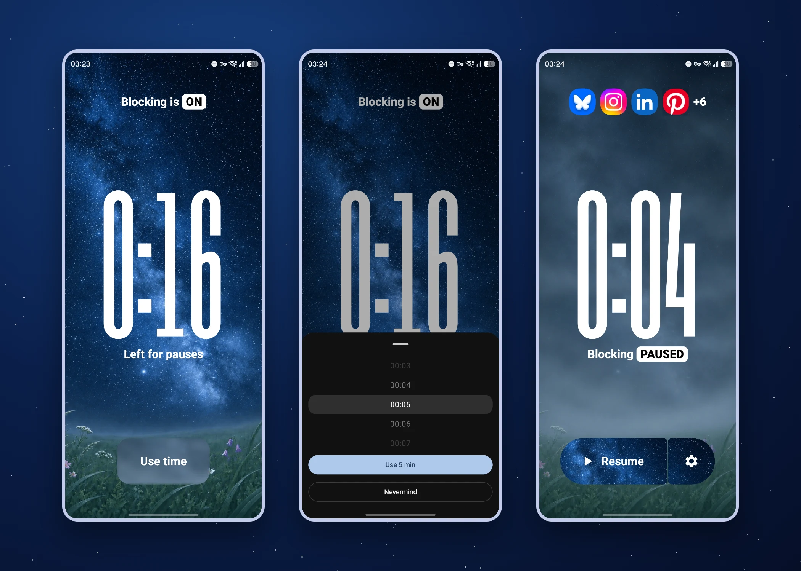
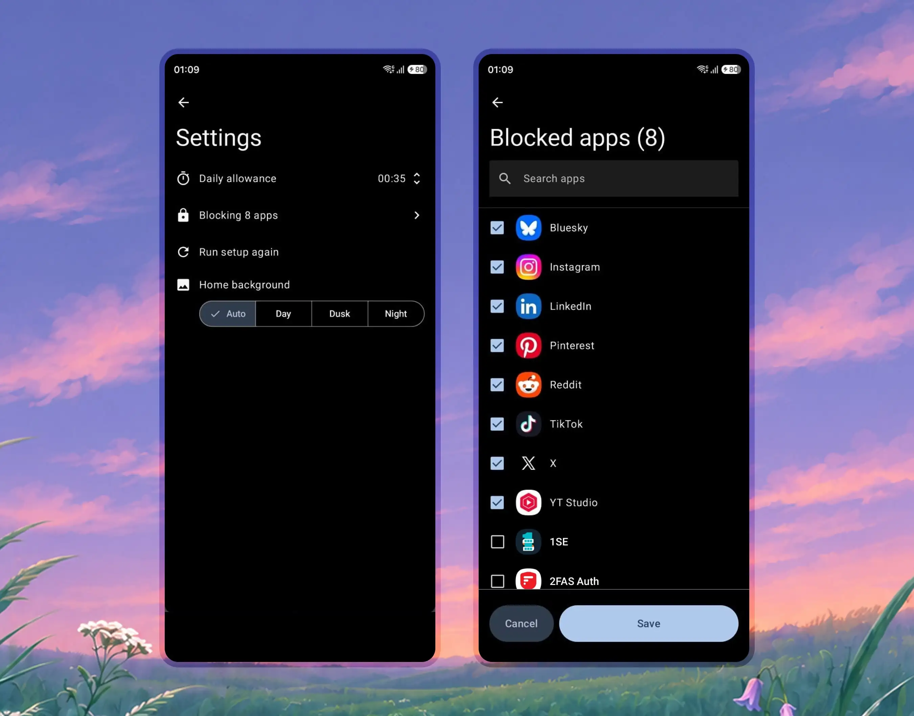
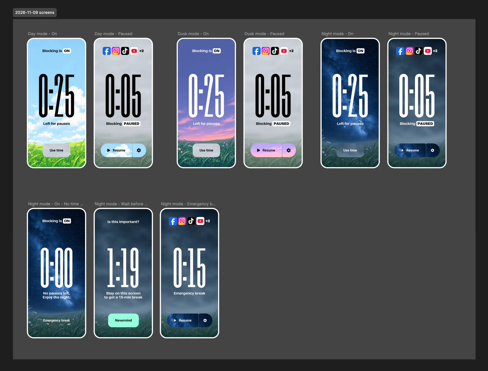
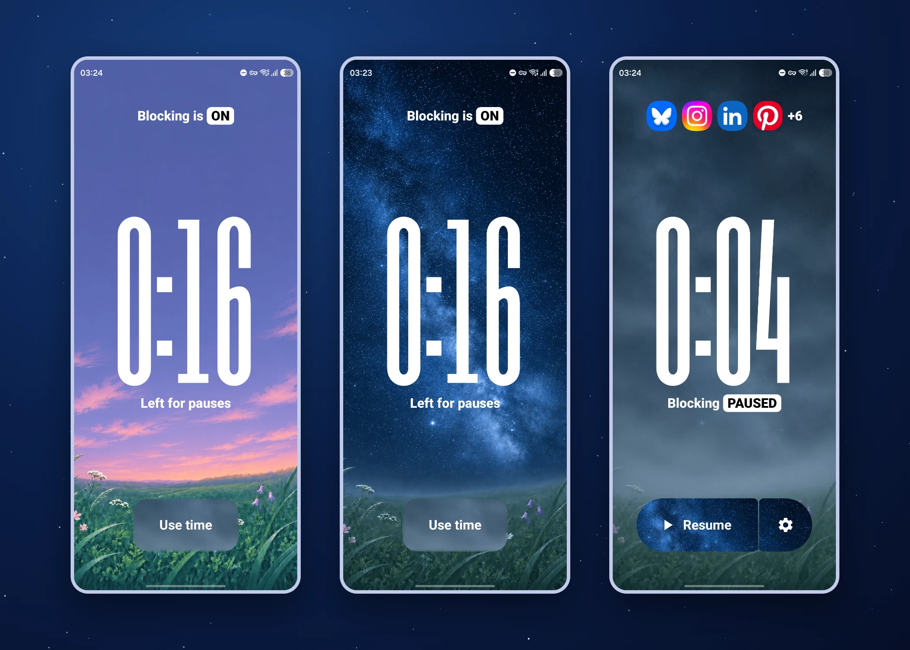

<video src="/assets/meadow/hero.mp4" width="1200" height="740" autoplay loop muted playsinline aria-label="Meadow in its day theme: blocking on and blocking paused."></video>

[Limit](https://freedom.to/limitapp) is a free iOS app from the makers of Freedom, which I also use. I emailed the developers and they have no immediate plans for an Android version, so I made my own take on it: **Meadow**.

## The idea

Choose which apps to block and for how long you can unblock them each&nbsp;day.

<video src="/assets/meadow/how-it-works-5x3.mp4" width="1440" height="864" autoplay loop muted playsinline aria-label="Meadow in its day theme: blocking on and blocking paused."></video>

When you pause blocking, the timer runs whether you use the apps or not.

That makes you think before you open the apps. Or rather, it retrains you to have a goal and estimate how much time you’ll need to complete it. It keeps you focused: “I only have 5 minutes this session, better be quick.”

Alternatively, you might choose to catch up with the people and companies you’re following. By setting a limit in advance (e.g. 15 minutes), you ensure you won’t end up spending hours in the apps without realizing.

<figure>
  
  <figcaption>The theme of the app changes automatically depending on the time of the day for an immersive feel.</figcaption>
</figure>

Standard screen time tools usually let you open and use an app normally until you hit the limit. But I don’t want to open the apps mindlessly, get sucked in, and accidentally hit the limit. 

I want to know **why** I’m opening them. I don’t want to delete them either because they are often useful and enjoyable. I just want to use them on my own terms to get what I want out of them.

<figure>
  
  <figcaption>The home screen has a cool unique look but the settings should usually not inovate. In this case they’re built with Material 3 Compose components for that native Android look and feel.</figcaption>
</figure>

## How I built it

I put Cursor (Grok) to work, first describing the functionality in detail and testing to make sure it works, then changing the UI incrementally to match the vibe I was going for. I used Figma to perfect the UI after getting the app to work on my phone.

Then I had Claude fix the myriad mistakes that Cursor had made. To be fair, when I started the project, I knew less about Android development than I do now and didn’t instruct Cursor as well as I could have.

## The visual metaphor

The meadow is clear when the apps are blocked, just like your mind. When the apps get unblocked, it’s foggy, like your brain. Personally, that slightly motivates me to keep the meadow clear and beautiful.

The feeling I want to evoke is “look at this beautiful meadow… let’s keep it that way”, and to have people realize it’s a metaphor for their own mind.

The theme switches automatically based on the time of day: dawn, day, dusk and night. You can also lock it to your favorite theme.

## What I learned

- How Android apps are built.
- What Jetpack Compose is (a UI kit with premade components following Material 3 guidelines written in Kotlin).
- How big of a difference video backgrounds make compared to static images when it comes to the vibe an apps gives off.
- How rarely I actually have a **reason** to open social media apps.